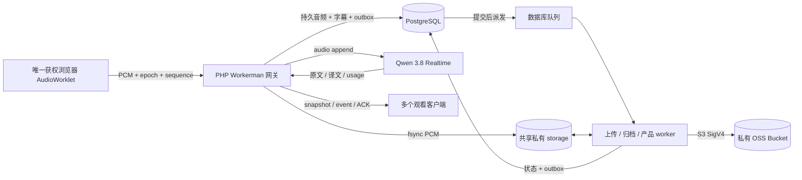

# 课堂同声传译：架构与协议

本文对应阶段 A、B、C 当前源码，说明运行边界与协议。原始需求完整保留在 [requirements.original.md](requirements.original.md)；需求验收和真实／模拟测试结果见 [acceptance.md](acceptance.md)，不由架构说明替代。

## 组件与数据流

PHP 8.5 / Laravel 13 处理 HTTP、身份、授权和业务事务；Workerman 5 常驻网关维护浏览器连接与 Qwen 连接。PostgreSQL 17 保存用户、设备会话、录音权、音频索引、字幕修订、配置版本、用量、审计和事务 outbox。Vue 3 / TypeScript / AudioWorklet 负责三语言界面、收音和显示；FFmpeg、AWS SDK 与文件导出在队列进程中运行。

浏览器不直接连接 Qwen，不持有模型或 OSS 密钥。原声播放使用授权后的短期 OSS 签名 URL；字幕导出由 HTTP 领取服务器私有文件。Redis 在 Compose 中承担跨进程 cache、限流和互斥锁，持久内容、HTTP session 与默认队列仍在 PostgreSQL。

## 权限与会话

`Access::lesson()` 是 HTTP 详情、历史字幕、分享、回放和 WebSocket 的共同阅读检查。课程必须启用，课程和课堂均未软删除。课程 `guest_access=public` 允许游客浏览；`link` 下游客必须先取得固定课堂分享授权，不能由此列举整个课程。已完成改密的有效成员可访问所有可用课程；目前没有按选课名单分配阅读权限的机制。

| 操作 | 游客／待首次改密用户 | 有效普通用户 | 管理员 |
| --- | --- | --- | --- |
| 阅读课堂、字幕、修订历史、分享与回放 | 公开课堂或该会话已有的课堂分享授权 | 可用课堂 | 可用课堂 |
| 创建课堂、重命名课堂 | 禁止 | 创建须课程可用且未归档；重命名须课堂可用并检查版本 | 同普通用户 |
| 开始／继续／暂停／上传音频 | 禁止 | 当前录音用户；暂停和上传还须唯一获权连接及当前 epoch | 同样约束；不能直接绕过录音权 |
| 结束课堂 | 禁止 | 当前录音用户或创建者，明确确认 | 明确确认；后台 HTTP 结束还需近期验证 |
| 邀请、申请、准备与离线接管录音权 | 禁止 | 按设备、邀请状态、宽限与确认检查 | 强制接管另需近期验证 |
| 校对、恢复文本版本 | 禁止 | 有阅读权，字段已完成且课堂未冻结编辑 | 同样受完成状态与冻结约束 |
| 创建／领取字幕导出 | 禁止 | 有阅读权；仅发起者查询、重试和领取 | 同样不能领取他人任务 |
| 录音附件下载 | 禁止 | 系统与课程两个下载开关均开启，且归档可播放 | 同样检查两个开关 |
| 课堂用量、本人设备 | 禁止 | 课堂用量须阅读权；设备仅本人 | 可另查管理员全站用量 |
| 用户、课程、术语、设置、冻结／删除、归档重试、清理 | 禁止 | 禁止 | 管理员；敏感修改需近期密码验证及相应确认 |

账户由管理员／初始化命令建立，没有自助注册。初始密码为字符串学号后六位，首次登录独立强制改密。90 天保持登录使用设备随机验证值与数据库 SHA-256；短 HTTP session 默认 120 分钟，敏感操作近期验证默认 15 分钟。会话、设备、账户 `auth_version` 与撤销标记共同阻止旧请求晚到写回恢复身份。详见 [accounts.md](accounts.md)。

修改 HTTP 请求有 CSRF；API 错误为稳定 `{code,params}`。WebSocket 精确校验 Origin，使用 30 秒一次性 ticket（数据库只存哈希），绑定 HTTP 设备 session 和课堂。命令、音频、广播与定时巡检重新检查现存 session、账户版本、禁用与课堂授权。退出、禁用、课程停用或分享撤销不会靠浏览器按钮维持保护。

模型与 OSS 设置加密版本化，公开／管理员响应仅含相应安全字段和密钥存在标记。模型地址限官方 Workspace／地域 WSS，OSS 限地域一致的阿里云公开 HTTPS endpoint，拒绝任意 URL、内网地址与重定向；只有服务端明确启用的 testing 环境允许 loopback 假模型。后台连接测试进入队列，模型用有界独立 PHP 子进程，OSS 只读写本次随机探针对象。

分享令牌随机且稳定，数据库仅保留哈希和 Crypt 密文；兑换时保存课堂、令牌版本与现存会话授权标记。正常登录／改密更换 session 会迁移授权，撤销设备会清理授权。分享仅提供观看权限。细节见 [B-content-sharing-exports.md](B-content-sharing-exports.md)。

## 独立状态与录音权

各项状态分别持久化，不能把“结束课堂”解释成“原声已可播放”。

| 对象 | 状态与转换 |
| --- | --- |
| 课堂 | `ready → live → paused → live → ended`；`ready` 也可直接结束。只有模型确认 `session.updated` 后才进入 `live`；`ended` 拒收后续音频 |
| 模型连接 | `connecting → configuring → ready → finishing → finished`；错误为 `failed`，主动紧急关闭可为 `closed`，进程恢复记为 `interrupted` |
| 字幕字段 | `streaming`；译文可先到 `text_done`；最终分别为 `completed/failed/incomplete/interrupted` |
| 原声归档 | `pending → processing → playable/failed`；显式管理员或 CLI 恢复可重新排队 |
| 字幕导出 | `queued → processing → ready/failed → expired`；到期清理文件和快照，失败可按权限和次数显式重试 |
| 交接 | `pending → preparing → completed`；也可 `rejected/cancelled/expired/failed` |
| 永久清理 | `queued → processing → purged/failed`；此前须结束并软删除，执行保留删除清单和审计 |

PostgreSQL 部分唯一索引保证同一课程最多一个未结束课堂。业务录音权属于 `recorder_user_id`；实际输入同时绑定随机连接标识、递增 `recorder_epoch` 和租约。继续／重新开始时 epoch 增加、包序号从零开始，课堂媒体样本数继续累计。同账户另一个标签页不会自动获得录音权。

前端心跳每 5 秒，默认租约 20 秒、离线接管宽限 30 秒、邀请 60 秒。断线安全暂停，保留业务持有者，恢复需要本人再次操作。交接须目标设备先准备麦克风，再原子更换持有者并撤销旧连接；旧 epoch 立即拒收。live 交接先结束旧模型，再向新设备发 `recorder.ready`，过渡期间暂停。详见 [recorder-handoffs.md](recorder-handoffs.md)。

暂停／结束由客户端先停止采集、处理尾包与 ACK，然后发命令；服务端封尾块、发送 `session.finish`，有界等待尾句。ended 状态先成立，归档在模型收尾后异步执行。故障时保存已确认原声与不确定区间，不自动开麦，也不自动把旧音频重放给供应商。

## 音频、媒体时间轴与 OSS 历史配置

AudioWorklet 使用真实 `AudioContext.sampleRate`，混为单声道，抗混叠 FIR 连续重采样至 16 kHz PCM16LE。正常包为 100 ms／1,600 samples／3,200 bytes，尾包允许 1–1,599 samples。二进制前 8 字节为 uint32 BE `epoch,sequence`，后面是小端 PCM，没有 WAV 或其他容器头。

音频行锁事务检查账户、持有连接、epoch、租约、预期序号、单课堂／UTC 全账户日样本额度和磁盘余量；本地临时文件 `fflush + fsync → rename`，随后提交音频索引、chunk 关联、计量与累计样本。事务提交后才发 `audio.ack`，再向当前 Qwen peer 发送 Base64 `input_audio_buffer.append`。

ACK 只证明本站本地持久接收，不能证明模型完成或 OSS 备份。重复 epoch／sequence 须内容 SHA-256 相同，还重新检查现存本地文件；重复包不增加样本或再次转发模型。gap、冲突或损坏明确报错。`model_delivery=sent` 仅记录本站 Socket 发送；供应商恰好一次接收没有保证。

全局 `media_samples / 16000` 是原声时间轴，暂停时间不加入媒体。每个模型连接保存 `base_sample`，供应商语音段起止毫秒换算为 `base_sample + ms × 16`。原文与译文为独立 unit；只按明确的 assistant `previous_item_id` 关联。缺少依据则保留 null／`unavailable`，不会用文字到达时间、墙钟或同序号猜测对应。`server_segment` 表示段落近似时间，不是逐词对齐；回放定位和带时间导出沿用此边界。

每个 epoch 的连续输入聚合为最多 100 帧／160,000 samples／320,000 bytes 的无损 PCM chunk。首帧派发延迟 10 秒上传任务，满块立即封闭并派发，暂停／结束封尾；块不跨 epoch、序号或样本缺口。短帧和 worker 调度可产生小块，10 秒加排队、重试、网络时间才是云备份延迟，不能承诺精确 10 秒恢复点。逐帧本地文件与索引仍保留，旧逐帧 OSS 对象和任务继续兼容。

首次收音固定课堂 OSS 位置。`StorageRegistry` 用 endpoint／region／bucket／prefix 指纹识别位置，加密保存完整凭据；相同位置凭据轮换更新加密 payload，新位置产生新版本。所有片段、块、归档与恢复使用其历史版本，未知／无法解密时失败，不回退当前环境变量。上传验证各帧 hash 与连续性，S3 PUT／multipart 后 HEAD 核对长度和 SHA 元数据。

归档从本地或历史 OSS 恢复输入，验证完整 PCM 时间线与样本总数，再由 FFmpeg 编码 AAC/M4A faststart、FFprobe 校验并完整解码；成品上传和 HEAD 成功才标记 playable。播放签名默认 120 秒，允许 30–900 秒；已签发 URL 有到期前的撤销窗口。详见 [storage.md](storage.md) 和 [disaster-recovery.md](disaster-recovery.md)。

## 字幕、可靠事件与恢复

模型事件按 session、provider event 与 unit 幂等。原文完成来自 transcription.completed；译文 `text.done` 不代表成功，最终依照 `response.done` 和 output 状态。模型原始最终文本、人工 `current_text`、修订版本分开保存；迟到模型结果不覆盖已完成原始文本或人工修订。批量校对按字段预期版本全事务提交，恢复旧版本也形成新记录。

字幕／业务修改与 `lesson_events` 在同一事务提交，写入和可靠 snapshot 均先锁同一课堂行。snapshot 读取最新 200 个未删除字段与该课堂 `last_seq`，并不表示全课堂只有 200 句。历史接口支持 `before_id`、关键词、`around_id`，按媒体 `at_sample` 可取对应窗口。

网关每 100 ms 查询尚未 `broadcasted_at` 的 outbox（每批最多 500），而非仅按一个全局最大值跳读，避免不同事务 bigserial 提交顺序造成丢失。发送后标记；进程中断可能重复发送，客户端按 seq 幂等。seq 是所有课堂共享的数据库序号，单课堂中的数值间隙不等于丢包。这个标记表示网关发送处理完成，不是每个浏览器持久确认。

重连重新领取 ticket，`subscribe.last_seq` 在 snapshot 的可靠 cutoff 内最多补回 500 条公开可靠事件。超限、首次连接或无效游标明确退回 snapshot；较早文本经分页读取。前端先按序应用 `missed_events`，再合并 snapshot，保留已加载历史而不将窗口外字段误删。`recorder.ready` 携权威 `lesson` 与独立 `lesson_seq`，避免旧状态事件覆盖新录音权。

启动恢复把活动课堂暂停、未完成模型／字幕标记 interrupted、取消活动邀请，并记录 `translation_uncertain`；已存原声保留。设备轨道结束、AudioContext 挂起或网络／缓冲故障可提交 `capture_uncertain`，未知缺失时长的 end_sample 保持 null。统一 `skip_unreceived`：只有本站收到的 PCM 进入媒体时间轴，不伪造缺失音频。详见 [C-settings-recovery.md](C-settings-recovery.md) 和 [process-recovery-testing.md](process-recovery-testing.md)。

## 模型轮换、冻结与用量

默认模型为 `qwen3.8-livetranslate-flash-realtime`，配置校验只接受该 3.8 协议系列；请求 `output_modalities:["text"]`，配置回显须符合目标语言与术语。课堂首次开始固定模型加密设置版本、术语版本及内容快照；继续、交接和轮换沿用。设置保存与首次启动使用相同 PostgreSQL 事务 advisory lock 顺序，避免 actor／设置锁反向等待。课程后来修改术语或活动模型配置只影响新课堂；旧授权被供应商撤销仍会失败。

每课堂有一个接收音频的 active peer，可以另有 preparing peer 与仅接收尾句的 draining peer。默认软阈值 600 秒／硬阈值 720 秒是本站可配置策略，按单调连接时间计，不是已知供应商最大连接时长。软阈值在观察到无待处理语音／文本／响应时准备下一连接；硬期限可强制近似边界。下一连接配置确认后，在一个输入包之前切换 active，设置新的 base_sample；此包仅发给新 peer，旧 peer 只 `finish` 收尾。

轮换不改变麦克风、录音权、epoch 或包序号，不发送新的 `recorder.ready`。可靠 `translation.rotation` 记录 preparing／switched／failed，含近似边界标志，切换时含 base_sample；失败有界重试，超出硬期限加连接超时会暂停。正常 finalize 记录本地 `sent_samples` 与完整计数标记；突然退出不能补造完整计数。观察到的空闲边界不是可靠静音保证，拆段质量和供应商恰好一次仍需独立评估。

精确样本账本和阈值预警与音频事务一致；官方 raw usage 单独保存并按会话／响应去重。费用仅使用管理员配置的地域、币种、计价项、每百万 token 十进制价格和生效时间，bcmath 分币种计算；缺 usage／价格显示未知，没有内置“官方价”。详见 [C-glossary-usage-qwen.md](C-glossary-usage-qwen.md)、[qwen-verification.md](qwen-verification.md) 和 [C-real-audio-rotation.md](C-real-audio-rotation.md)。

## HTTP 与 WebSocket 契约索引

| HTTP 分组 | 主要入口／细节文档 |
| --- | --- |
| 身份／设备／用户导入 | `/api/me, login, password, logout, reauth, devices`，`/api/admin/users, imports`；[accounts.md](accounts.md) |
| 课程／课堂／历史 | `/api/courses`，`/api/courses/{id}/lessons`，`/api/lessons/{id}` 与 `/subtitles`；课堂后台 `/api/admin/lessons`，结束、归档重试、软删除／恢复 |
| 修订／分享／导出 | `/api/lessons/{id}/subtitles`、字段 `/history, restore`，`/share`、`/s/{token}`，`/exports`、`/api/exports/{id}`；[B-content-sharing-exports.md](B-content-sharing-exports.md) |
| 设置／连接测试／恢复／回放 | `/api/public-settings`，`/api/admin/settings`、`/connection-tests/{id}`、`/diagnostics`，课堂 `/capture-issue, issues, playback, download`；[C-settings-recovery.md](C-settings-recovery.md) |
| 术语／用量 | `/api/admin/courses/{id}/glossary`，`/api/lessons/{id}/usage`、`/api/admin/usage`；[C-glossary-usage-qwen.md](C-glossary-usage-qwen.md) |

| WS 消息 | 作用与核心字段 |
| --- | --- |
| `subscribe {ticket,last_seq}` → `snapshot` | 未订阅连接 10 秒关闭；返回 `{lesson,units,last_seq,missed_events,recovery}` |
| `heartbeat` | 客户端每 5 秒发送；刷新当前连接租约并返回 heartbeat |
| `start/resume` → `recorder.ready` | 配置确认后返回 `{epoch,next_sequence,media_samples,lesson,lesson_seq}`，才可上传 |
| 二进制音频 → `audio.ack` | `{sequence,media_samples}`；可信范围仅为本站持久接收 |
| `pause {epoch}`／`end {confirmed:true}` | 按录音权与结束权限检查，并有界收尾 |
| `recording.invite/request/respond/prepared/takeover` | 交接协议；私有 `handoffs` 与 `recording.prepare/transferred`，见交接文档 |
| `event {seq,event_type,payload}` | 可靠字幕／状态事件，如 `subtitle.updated, lesson.updated, handoff.updated, recording.issue, usage.warning, translation.rotation` |
| `presence`／`lesson.progress` | 临时在线人数／成员姓名／媒体进度；游客不收成员列表，没有历史重放保证 |
| `error {code,params}` | 稳定安全错误；不存在生产模拟字幕回退 |

`control.*` 是服务器内部 outbox 命令（如管理员结束），不广播或重放给观看者。客户端发送频率、音频速度、WS 大小与缓冲都有上限；拥塞关闭连接并安全暂停。

## 进程、队列与保留

Compose 为 HTTP PHP-FPM、Nginx、单 Workerman gateway、recordings worker、archives worker、产品 worker、scheduler、PostgreSQL 和 Redis 独立服务。网关 worker count=1，并持有数据库级 session advisory lock；PDO 重连导致 backend PID 变化或持久化回调失败会关闭全部上游并停止网关，由监督进程重启。当前没有多网关横向扩展协议。

| 队列／调度 | 职责与运行边界 |
| --- | --- |
| `recordings` | UploadChunk 与兼容 UploadSegment；云上传、校验，Compose worker timeout 150 秒 |
| `archives` | ArchiveLesson；恢复 PCM、FFmpeg／FFprobe、上传归档，timeout 7,200 秒 |
| `exports` | 不可变字幕快照生成 TXT／Markdown／SRT／VTT 私有文件，job timeout 300 秒 |
| `imports` | 已确认 Excel 预检快照，事务写账户；timeout 1,800 秒 |
| `maintenance` | 连接测试、清理、录音 reconciliation；产品 worker 同时消费 exports/imports/maintenance，timeout 1,800 秒 |
| scheduler | 每 5 分钟派发录音扫描、每小时清导出和过期会话撤销标记、每日派发保存策略 |

默认数据库队列提交后派发，`retry_after=7500` 大于最长任务 7200 秒。上传、归档、导出和清理共用 `lesson-data:<id>` cache 锁，防止清理与发布内容并行；各任务还可有对象自身锁。新媒体／导出／清理任务固定 24 小时 retryUntil，tries=0 让锁等待不耗尽普通次数，真实异常仍由各自 maxExceptions 限制；旧序列化 payload 不会自动获得新策略。真实 Linux pcntl worker 才能执行对应强制超时，本机 Windows 验证不替代它。

自动录音扫描共用全局锁，总计最多 100 项，封尾并恢复 pending 或失联处理中项，不自动复活已 failed 的任务；人工 CLI／后台重试必须明确操作。字幕导出保留 24 小时，最多 20,000 字段／8 MiB 文本；权限、到期与归档并发都重新检查。没有可用时间的 SRT／VTT 段会明确跳过，全部不可计时则失败，TXT／Markdown 可保留无时间文本。

保存策略默认长期保留且关闭 auto_purge。软删除保留内容，永久清理由 ended + deleted 课堂开始，按历史配置和持久删除清单逐个删除 OSS／规范本地文件、字幕及导出快照；审计、清理状态、部分运行元数据与独立备份仍保留，不声称彻底抹除所有副本。清理状态非 null 后，网关与恢复回调在课堂锁内拒绝迟到正文、故障、课堂状态与事件写入，防止旧模型尾句重建已清理内容；仅保留模型元数据／用量，见 [late-model-purge-verification.md](late-model-purge-verification.md)。所有进程须共享私有 storage、同一 cache 后端与 APP_KEY／历史密钥。完整部署、备份和实际验证边界见 [README](../README.md)、[storage.md](storage.md)、[disaster-recovery.md](disaster-recovery.md)、[load-testing.md](load-testing.md) 和 [final-concurrency-verification.md](final-concurrency-verification.md)。
